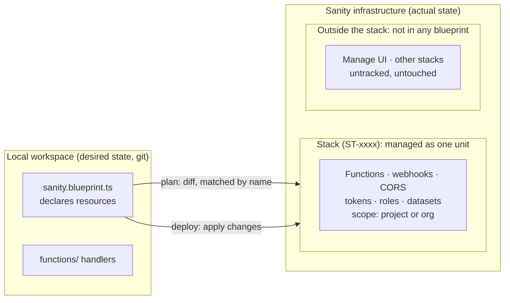

<!-- GENERATED by tools/context.py from https://docs.sanity.io/llms-full.txt — do not edit. -->

# Sanity

Nobody publishes a machine-readable description of this API, so there is no pack for it
and no operation in this directory can be called. What follows is the vendor's own
documentation index, kept as context. **Nothing here is an endpoint this directory
vouches for**: read it, then read their reference.

- API: `https://mcp.sanity.io`
- Credential: `SANITY_MCP_TOKEN` (oauth)
- Source: https://docs.sanity.io/llms-full.txt

---
# Manage Sanity with code

#### Get started

[Introduction](https://www.sanity.io/docs/blueprints/blueprints-introduction)
Learn what Blueprints are, how they work, and how to get started.

[Your first Blueprint](https://www.sanity.io/docs/blueprints/your-first-blueprint)
Set up a blueprint, run a plan, and deploy your first resource (a CORS origin) to a real Sanity stack.

[Create a Sanity Function](https://www.sanity.io/docs/functions/function-quickstart)
Use Blueprints to create a function

[Deploy Blueprints with GitHub Actions](https://www.sanity.io/docs/blueprints/blueprint-action)
Use the official Blueprints actions to plan and deploy your Blueprints with GitHub Actions.

#### Concepts

[Stacks and scope](https://www.sanity.io/docs/blueprints/stacks-and-scope)
How one blueprint file maps to many stacks, and what project versus organization scope means.

[The resource graph](https://www.sanity.io/docs/blueprints/resource-graph)
How resources reference each other with the $ syntax, and why a blueprint file is a connected system.

[Manage environments with Blueprints](https://www.sanity.io/docs/blueprints/manage-environments)
Deploy one blueprint file to staging, production, and other stacks.

[Errors and rollbacks](https://www.sanity.io/docs/blueprints/errors-and-rollbacks)
How Blueprints catches mistakes early and what happens when a deploy fails.

#### Reference documentation

[Configuration reference](https://www.sanity.io/docs/blueprints/blueprint-config)
Reference documentation for the Blueprint configuration files.

[Blueprints CLI command reference](https://www.sanity.io/docs/cli-reference/cli-blueprints)
Reference documentation for the Sanity CLI Blueprints command.

[Blueprints scopes reference](https://www.sanity.io/docs/blueprints/scopes)
Project versus organization scope, which resource types need which scope, and how the CLI resolves scope.

[Blueprints glossary](https://www.sanity.io/docs/blueprints/glossary)
Definitions of the core Blueprints terms: stacks, scopes, values, deletion policies, and more.

# Introduction

Blueprints enables infrastructure-as-code level management of Sanity resources.

Blueprints replaces one-off changes in the web interface with a **declarative** workflow. You describe the resources you want in one file, the **blueprint file** (`sanity.blueprint.ts`, sometimes called the manifest), and keep it in your repository alongside your application code. When you deploy, Sanity compares the file against what already exists and makes reality match it. If it's not in the blueprint, it's not deployed: the file is the source of truth.

Managing resources this way has a few compounding benefits:

- **Auditable:** Your setup lives in version control next to your code. Changes go through pull requests and have a history.
- **Reproducible:** Create staging or per-developer environments from the same file, so environments stay consistent instead of drifting apart.
- **Deterministic:** A plan shows the exact changes before you apply them.
- **Faster onboarding:** A teammate runs `sanity blueprints init`, points at a stack, and deploys.

#### Get started

[Your first Blueprint](https://www.sanity.io/docs/blueprints/your-first-blueprint)
Set up a blueprint, run a plan, and deploy your first resource (a CORS origin) to a real Sanity stack.

## Requirements

- We recommend the latest version of the Sanity CLI (`sanity@latest`) for working with Blueprints and Functions. You can always run the latest CLI commands with `npx sanity@latest`.
- Permissions:- Project-scoped stacks require the Administrator, Developer, or Blueprints Deployer role in the project, or another role or robot token with the `sanity.project.blueprints.deploy` permission. For CI, use a robot token with the Blueprints Deployer role.
- Organization-scoped stacks require the Administrator role in the organization, or an organization robot token with the `sanity.blueprints.deploy` permission.

## Core concepts

### Blueprint

Like a configuration file, a blueprint lets you define and customize Sanity resources.

[Blueprint configuration reference](https://www.sanity.io/docs/blueprints/blueprint-config)
Reference documentation for the Blueprint configuration files.

### Resource

Core Sanity components are resources. You can create and update resources by defining them in a blueprint. Resources range from infrastructure like datasets and functions to applications and singleton configs such as Media Library.

#### Define resources with Blueprints

[Functions](https://www.sanity.io/docs/functions/functions-introduction)
Learn how to take advantage of Functions in your Sanity projects.

[Define a webhook with Blueprints](https://www.sanity.io/docs/blueprints/blueprints-webhook)
Blueprints let you define and manage your webhooks in code, then deploy them in a predictable manner.

[Define a CORS origin with Blueprints](https://www.sanity.io/docs/blueprints/blueprints-cors)
Blueprints allow you to define and manage your CORS origins in code, then deploy them in a predictable manner. 

[Define a robot token with Blueprints](https://www.sanity.io/docs/blueprints/blueprints-robot-tokens)
Blueprints let you create robot tokens alongside other resources for use in the blueprint.

[Define a role with Blueprints](https://www.sanity.io/docs/blueprints/blueprints-role)
Use Blueprints to define a custom role in code alongside your project's other resources.

### Stack



A stack is a collection of resources that are managed as a single unit. Stacks are linked to a project or an organization and can be multiple deployments of the same `sanity.blueprint.ts` configuration, or deployments for different blueprint configurations entirely.

For example, the marketing team might have a `sanity.blueprint.ts` that defines resources deployed to the `marketing` stack, while the commerce team may have their own `sanity.blueprint.ts` that deploys resources to the `commerce` stack.

You can view stacks with the `sanity blueprints stacks` command, and switch stacks by running `sanity blueprints init` or `sanity blueprints config --edit` in an existing blueprints project. To list, inspect, and remove stacks, see [Manage stacks](https://www.sanity.io/docs/blueprints/manage-stacks).

#### Stack scopes

You can scope stacks to a project or to an organization. For how scope affects resources and how promotion works, see [Stacks and scope](https://www.sanity.io/docs/blueprints/stacks-and-scope).

- For project-scoped stacks, all resources default to the stack’s project. 
- For organization-scoped stacks, you must explicitly set a resource’s project (when applicable) as part of the resource’s blueprint configuration, unless the stack has a default project. A stack promoted from project scope gets a default project, so its resources that don't name a project keep resolving to it.

Some resources, like [Scheduled Functions](https://www.sanity.io/docs/functions/scheduled-function-quickstart), require an organization-scoped stack.

### Definer

A definer is a typed function such as `defineCorsOrigin` or `defineRole` that you call to declare a resource. Its types flag mistakes in your editor, and it validates values when the CLI loads the file, before anything is deployed. A blueprint file is a list of resources, each created with a definer:

**sanity.blueprint.ts**

```typescript
import { defineBlueprint, defineCorsOrigin } from '@sanity/blueprints'

export default defineBlueprint({
  values: {
    projectId: process.env.PROJECT_ID,
  },
  resources: [
    defineCorsOrigin({
      name: 'studio-cors',
      project: '$.values.projectId',
      origin: 'https://my-studio.sanity.studio',
      allowCredentials: true,
    }),
  ],
})
```

The `values` block holds reusable constants (strings or numbers), referenced with `$.values.KEY_NAME`. The example reads the project ID from the environment, so the file carries no hard-coded IDs.

> [!NOTE]
> Make changes in the blueprint file
> Blueprints manages the resources it knows about. If you change a Blueprint-managed resource in another Sanity interface, Blueprints won't see the change until the next `plan` shows the difference. Treat the blueprint file as the source of truth.

## Limitations

### Stack limit

By default, each project or organization can have up to 10 stacks. To free a slot, remove a stack you no longer use. See [Manage stacks](https://www.sanity.io/docs/blueprints/manage-stacks).

### No nested blueprints

When creating multiple blueprints in a single project, you cannot nest blueprints in subdirectories of a directory containing a `sanity.blueprint.ts` file.

❌ For example, don't do this:

**Don't do this**

```text
.
└── some-project/
    ├── sanity.blueprint.ts
    └── another-project/
        └── sanity.blueprint.ts
```

✅ Instead, do this:

**Do this**

```text
.
├── some-project/
│   └── sanity.blueprint.ts
└── another-project/
    └── sanity.blueprint.ts
```

### Applications

Applications and singleton configs are deployable as blueprint resources. A few adjacent capabilities are out of scope for now:

- There's no whole-blueprint local dev flow. Applications keep their existing local development flow.
- Blueprints references existing Media Library, Canvas, and Dashboard resources; it doesn't create them.
- Creating a schema resource is handled by a separate initiative.

# Stacks and scope

## Blueprint files and stacks

The [blueprint file](https://www.sanity.io/docs/blueprints/blueprint-config) is what you edit. A **stack** is what it becomes once deployed: the live set of resources on Sanity's side. The relationship is one-to-many. A single file can deploy to several stacks, which is what makes environments straightforward: the same file produces a `staging` stack and a `production` stack, selected with the `--stack` flag at deploy time. See [Manage environments with Blueprints](https://www.sanity.io/docs/blueprints/manage-environments).

The link between your local file and a particular stack lives in `.sanity/blueprint.config.json`, the **blueprint config file**. It records the scope and the stack. It's gitignored by default and isn't secret, so a team can commit it to share a default.

To list your stacks, see which one your local blueprint uses, or remove one, see [Manage stacks](https://www.sanity.io/docs/blueprints/manage-stacks).

## Two scopes

Every stack has a scope: **project** or **organization**. The blueprint file doesn't encode scope; the config file does. A `projectId` makes the stack project-scoped; an `organizationId` makes it organization-scoped.

##### Project vs organization scope

|  | Project scope | Organization scope |
| --- | --- | --- |
| Boundary | One Sanity project | An entire organization |
| Resource's project | Defaults to the stack's project | Set project on each project-scoped resource |
| Org-scoped resource types | Not available | Available (for example, scheduled functions) |

> [!TIP]
> Recommendation
> Organization scope is the recommended path. It unlocks organization-scoped resource types and scales cleanly to multi-project setups. On an org-scoped stack, give each project-scoped resource an explicit `project`; the common pattern is to supply `$.values.projectId` from an environment variable.
> Starting with project scope is completely fine, too. You can move to organization scope at any time with `blueprints promote`. See [Promote a stack to organization scope](https://www.sanity.io/docs/blueprints/promote-stack-to-organization-scope).

## Why scope matters

Some resource types only make sense above a single project. Scheduled (cron) functions, for example, need an organization-scoped stack. If a stack is project-scoped and you add an organization-scoped resource type, the deploy tells you to promote the stack first.

The [scopes reference](https://www.sanity.io/docs/blueprints/scopes) covers which resource types need which scope.

## Promotion: from project to organization

`blueprints promote` converts a project-scoped stack to organization scope in place, so you never have to start over. It's a safe, additive change: it unlocks new capabilities without changing how your existing resources behave. Blueprints assigns the stack a default project, so project-scoped resources that don't name a `project` keep resolving to the project they always used.

Promotion is one-way (there's no demote), but nothing about your stack stops working. For the full steps, see [Promote a stack to organization scope](https://www.sanity.io/docs/blueprints/promote-stack-to-organization-scope).

#### Related

[Manage environments with Blueprints](https://www.sanity.io/docs/blueprints/manage-environments)
Deploy one blueprint file to staging, production, and other stacks.

[Manage stacks](https://www.sanity.io/docs/blueprints/manage-stacks)
List your Blueprints stacks, see which stack your local blueprint deploys to, and remove stacks you no longer need.

[Blueprints scopes reference](https://www.sanity.io/docs/blueprints/scopes)
Project versus organization scope, which resource types need which scope, and how the CLI resolves scope.

[Promote a stack to organization scope](https://www.sanity.io/docs/blueprints/promote-stack-to-organization-scope)
Learn how to promote an existing project-scoped blueprint stack to organization scope to unlock scheduled functions.

# Manage environments with Blueprints

## The pattern

Keep one blueprint file. Read an environment variable inside it to select per-environment configuration, then deploy each stack with the environment variable and the `--stack` flag traveling together. The file stays the source of truth; the variable picks which values to apply.

**sanity.blueprint.ts**

```typescript
import { defineBlueprint, defineCorsOrigin } from '@sanity/blueprints'

const env = process.env.SANITY_ENV ?? 'production'

const config = {
  staging: { origin: 'https://staging.example.com' },
  production: { origin: 'https://www.example.com' },
}[env]

export default defineBlueprint({
  values: {
    projectId: process.env.PROJECT_ID,
  },
  resources: [
    defineCorsOrigin({
      name: 'web-cors',
      project: '$.values.projectId',
      origin: config.origin,
      allowCredentials: false,
    }),
  ],
})
```

## Add a second stack

Re-run `init` in the existing directory. It detects the existing blueprint file, skips scaffolding, and goes straight to configuration so you can create or select a stack. Pass `.` to target the current directory directly:

**npm**

```shell
npx sanity@latest blueprints init .
```

**pnpm**

```shell
pnpm dlx sanity@latest blueprints init .
```

**yarn**

```shell
yarn dlx sanity@latest blueprints init .
```

**bun**

```shell
bunx sanity@latest blueprints init .
```

## Deploy each environment

Pass the environment variable and the matching `--stack` on the same command:

**CLI**

```sh
SANITY_ENV=staging    npx sanity@latest blueprints deploy --stack staging
SANITY_ENV=production npx sanity@latest blueprints deploy --stack production
```

List your stacks at any time:

**npm**

```shell
npx sanity@latest blueprints stacks
```

**pnpm**

```shell
pnpm dlx sanity@latest blueprints stacks
```

**yarn**

```shell
yarn dlx sanity@latest blueprints stacks
```

**bun**

```shell
bunx sanity@latest blueprints stacks
```

## How targeting works

##### How targeting works

| Mechanism | What it does |
| --- | --- |
| --stack <name-or-id> | Selects which deployed stack to act on. Available on deploy, plan, info, and logs. |
| SANITY_ENV | A convention read by your file, not by the CLI. Name it whatever you like; the example above reads it to pick config. |

> [!WARNING]
> --stack never creates a stack
> `--stack` does not create a stack on a miss. It fails and points you to create one with `init` (or the interactive `config --edit`). This is deliberate, so CI cannot accidentally provision stacks.

> [!NOTE]
> Environment files are not auto-loaded
> The CLI does not auto-load `.env` files. Pass environment variables explicitly on the command, as shown above.

## Other ways to split stacks

Staging and production are the most common reason to run multiple stacks, but not the only one. The same one-file, many-stacks pattern applies when you split by:

- **Content division**: one stack per brand or property (`artist-1`, `artist-2`).
- **Business area**: `marketing`, `sales`.
- **Region**: a stack per locale or data region.

Pick the dimension that matches how your team is organized, and select it with `--stack` the same way.

#### Related

[Stacks and scope](https://www.sanity.io/docs/blueprints/stacks-and-scope)
How one blueprint file maps to many stacks, and what project versus organization scope means.

[Deploy Blueprints from CI](https://www.sanity.io/docs/blueprints/deploy-blueprints-from-ci)
How to deploy your Blueprint automatically from any CI system using a deploy token and environment variables.

[Blueprints CLI command reference](https://www.sanity.io/docs/cli-reference/cli-blueprints)
Reference documentation for the Sanity CLI Blueprints command.

# The resource graph

## Two kinds of reference

Inside a blueprint file you address other values with a small `$` syntax, passed as a plain string. There are two forms you'll use most:

##### Reference syntax

| Syntax | Resolved | Use it for |
| --- | --- | --- |
| $.values.<key> | When the file runs (eval time) | A reusable constant from the values block, such as a project ID. |
| $.resources.<name> | At deploy time | A reference to another resource in the same file. This creates a dependency edge. |
| $.resources.<name>.id | At deploy time | The generated ID of another resource, usable as a string once it exists. |

## Values: constants you reuse

A value is **always a string** (not an object or array). Define it once in the `values` block and reference it with `$.values.<key>` wherever it's needed. The most common use is a project ID drawn from the environment, so the file carries no hard-coded IDs:

**sanity.blueprint.ts**

```typescript
import { defineBlueprint, defineCorsOrigin, defineDocumentWebhook } from '@sanity/blueprints'

export default defineBlueprint({
  values: {
    projectId: process.env.PROJECT_ID,
  },
  resources: [
    defineCorsOrigin({
      name: 'studio-cors',
      project: '$.values.projectId',
      origin: 'https://my-studio.sanity.studio',
      allowCredentials: true,
    }),
    defineDocumentWebhook({
      name: 'revalidate',
      project: '$.values.projectId',
      dataset: 'production',
      apiVersion: 'v2025-02-19',
      url: 'https://example.com/api/revalidate',
      on: ['create', 'update', 'delete'],
    }),
  ],
})
```

Values resolve when the file runs, so they can't be built from things that only exist at deploy time. If you need to compose a string, do it in plain JavaScript at the top of the file and assign the result to a value.

## Resource references: edges in the graph

When one resource names another with `$.resources.<name>`, Blueprints records a dependency: the referenced resource is resolved before the resource that points at it. A robot token that uses a role defined in the same file is a clear example:

**sanity.blueprint.ts**

```typescript
import { defineBlueprint, defineRole, defineRobotToken } from '@sanity/blueprints'

export default defineBlueprint({
  values: {
    projectId: process.env.PROJECT_ID,
  },
  resources: [
    defineRole({
      name: 'ci-deploy-role',
      title: 'CI Deploy Role',
      appliesToUsers: false,
      appliesToRobots: true,
      permissions: [{ name: 'sanity-project-cors', action: 'create' }],
    }),
    defineRobotToken({
      name: 'ci-robot',
      memberships: [
        {
          resourceType: 'project',
          resourceId: '$.values.projectId',
          // references the role above, so it's created first
          roleNames: ['$.resources.ci-deploy-role'],
        },
      ],
    }),
  ],
})
```

You don't order resources yourself. Blueprints reads the references, builds the graph, and arranges the work so each dependency exists before it's needed.

> [!WARNING]
> References are validated
> A reference to a resource that doesn't exist, or a cycle where two resources depend on each other, fails validation before anything is deployed.

## Why this matters

The graph is what makes a blueprint file more than a pile of settings. It records how your resources relate (this token uses that role, this webhook watches that dataset) and makes those relationships explicit, reviewable, and reproducible. Change one resource and the connected ones come along with it.

## Referencing across stacks

A resource in one stack can hold a read-only reference to a resource in another stack in the same scope. This is an advanced, evolving capability. For the common case of pointing resources at an existing project, define the project ID as a value and supply it from the environment, as shown above.

#### Related

[Blueprints introduction](https://www.sanity.io/docs/blueprints/blueprints-introduction)
Learn what Blueprints are, how they work, and how to get started.

[Blueprint configuration reference](https://www.sanity.io/docs/blueprints/blueprint-config)
Reference documentation for the Blueprint configuration files.

# Errors and rollbacks

## Most errors happen before deploy

Validation runs at more than one point, so problems surface as early as possible:

- **Before applying.** When you run `plan` or `deploy`, the whole file is validated (structurally and per resource) before any change is made.

Because `plan` is read-only, running it is the safe way to surface most errors without touching anything.

## Kinds of failure

##### Kinds of failure

| Failure | What it means |
| --- | --- |
| Validation error | A resource is missing a required field, has an invalid value, or the file is structurally wrong. Caught before deploy. |
| Unresolved reference or cycle | A $.resources.<name> points at something that doesn't exist, or two resources depend on each other. See The resource graph. |
| Scope mismatch | An organization-scoped resource type on a project-scoped stack, or a project-scoped resource with no resolvable project. See Stacks and scope. |
| Deletion-policy violation | A change would remove a resource whose deletion policy forbids it (for example a retain or protect resource). |
| Execution failure | A change passed validation but failed while being applied; for instance, an underlying service rejected it. |

Errors come back with a clear name, a human-readable message, and the path to the resource involved, so you can map the failure straight to a line in your file.

## What rollback does

If a deploy fails after some changes have already been applied, Blueprints attempts to undo the completed changes in reverse order and marks the operation as failed. The goal is to leave the stack consistent rather than half-applied.

> [!WARNING]
> Rollback is best-effort
> Rollback unwinds the actions it can, in reverse. It isn't a guaranteed atomic restore of the entire stack: some actions may not be reversible, and references to resources owned by other stacks are never touched. After a failed deploy, run `blueprints info` to see the current state, fix the cause, and deploy again.

## Reading what happened

A deploy streams its progress until the operation finishes. To review a past deploy after it has stopped tailing, including the messages from a failure, use the logs:

**npm**

```shell
# Inspect current state
npx sanity@latest blueprints info

# Re-read logs from earlier operations
npx sanity@latest blueprints logs
```

**pnpm**

```shell
# Inspect current state
pnpm dlx sanity@latest blueprints info

# Re-read logs from earlier operations
pnpm dlx sanity@latest blueprints logs
```

**yarn**

```shell
# Inspect current state
yarn dlx sanity@latest blueprints info

# Re-read logs from earlier operations
yarn dlx sanity@latest blueprints logs
```

**bun**

```shell
# Inspect current state
bunx sanity@latest blueprints info

# Re-read logs from earlier operations
bunx sanity@latest blueprints logs
```

## Recovering

1. Read the error message and the resource path it points to.
2. Fix the blueprint file (or the underlying resource, if something external changed).
3. Run `blueprints plan` to confirm the diff is now what you expect.
4. Run `blueprints deploy` again.

#### Related

[The resource graph](https://www.sanity.io/docs/blueprints/resource-graph)
How resources reference each other with the $ syntax, and why a blueprint file is a connected system.

[Stacks and scope](https://www.sanity.io/docs/blueprints/stacks-and-scope)
How one blueprint file maps to many stacks, and what project versus organization scope means.

[Blueprints CLI command reference](https://www.sanity.io/docs/cli-reference/cli-blueprints)
Reference documentation for the Sanity CLI Blueprints command.

# Your first Blueprint

You'll set up a blueprint, run a plan, and deploy your first resource (a CORS origin) to a real Sanity stack. By the end you'll have run the full edit, plan, deploy loop you use for everything else.

## Before you begin

- **Node.js and npm** installed.
- **A Sanity account, logged in.** If you're not sure, run `npx sanity@latest login`.
- **An existing Sanity project**, and its **project ID** (from the project's settings).

New to the ideas behind this? Read the [Blueprints introduction](https://www.sanity.io/docs/blueprints/blueprints-introduction) first. Otherwise, start in an empty directory.

## Step 1: Initialize a blueprint

Run `init` and follow the prompts:

**npm**

```shell
npx sanity@latest blueprints init
```

**pnpm**

```shell
pnpm dlx sanity@latest blueprints init
```

**yarn**

```shell
yarn dlx sanity@latest blueprints init
```

**bun**

```shell
bunx sanity@latest blueprints init
```

The interactive setup walks you through a few choices:

- Confirm the directory to create the blueprint in.
- Choose your **organization** as the scope.
- Name the new stack `production`.
- Choose **TypeScript** as the format.

When it finishes, you'll have:

- `sanity.blueprint.ts`, the blueprint file you'll edit.
- `.sanity/blueprint.config.json`, which links the file to the new stack (gitignored by default).
- `@sanity/blueprints` added to your `package.json`.

## Step 2: Install dependencies

The blueprint file is real TypeScript, so install the package it imports:

**npm**

```shell
npm install
```

**pnpm**

```shell
pnpm install
```

**yarn**

```shell
yarn install
```

**bun**

```shell
bun install
```

## Step 3: Look at the empty stack

`init` created a stack with no resources yet. Confirm that:

**npm**

```shell
npx sanity@latest blueprints info
```

**pnpm**

```shell
pnpm dlx sanity@latest blueprints info
```

**yarn**

```shell
yarn dlx sanity@latest blueprints info
```

**bun**

```shell
bunx sanity@latest blueprints info
```

You'll see the stack you just created, with zero resources. `info` shows what's live and which stack you're connected to.

## Step 4: Declare a resource

Open `sanity.blueprint.ts` and replace its contents with the blueprint file below. It declares one CORS origin so a hosted Studio can call your project's API. Swap in your own project ID:

**sanity.blueprint.ts**

```typescript
import { defineBlueprint, defineCorsOrigin } from '@sanity/blueprints'

export default defineBlueprint({
  resources: [
    defineCorsOrigin({
      name: 'studio-cors',
      project: 'your-project-id',
      origin: 'https://my-studio.sanity.studio',
      allowCredentials: true,
    }),
  ],
})
```

What you just wrote:

- `defineCorsOrigin` is a **definer**, a typed function that checks your input as you write it.
- `name` is the resource's identity in the stack.
- `project` is the project the CORS origin belongs to.
- `allowCredentials: true` lets authenticated requests through, which a Studio needs.

## Step 5: Run a plan

Before changing anything, see what a deploy would do. `plan` is read-only:

**npm**

```shell
npx sanity@latest blueprints plan
```

**pnpm**

```shell
pnpm dlx sanity@latest blueprints plan
```

**yarn**

```shell
yarn dlx sanity@latest blueprints plan
```

**bun**

```shell
bunx sanity@latest blueprints plan
```

The output shows a single **create** action for `studio-cors`. Nothing has been created yet:

**blueprints plan**

```text
Deployment Plan
  + create  studio-cors  sanity.project.cors

  1 create
```

## Step 6: Deploy

Apply the plan:

**npm**

```shell
npx sanity@latest blueprints deploy
```

**pnpm**

```shell
pnpm dlx sanity@latest blueprints deploy
```

**yarn**

```shell
yarn dlx sanity@latest blueprints deploy
```

**bun**

```shell
bunx sanity@latest blueprints deploy
```

`deploy` applies the change and streams progress until the stack finishes updating. When it's done, your CORS origin is live.

## Step 7: Confirm it's live

**npm**

```shell
npx sanity@latest blueprints info
```

**pnpm**

```shell
pnpm dlx sanity@latest blueprints info
```

**yarn**

```shell
yarn dlx sanity@latest blueprints info
```

**bun**

```shell
bunx sanity@latest blueprints info
```

This time `studio-cors` appears under the stack's resources. The deployed state matches your file.

> [!TIP]
> Reading past logs
> `deploy` stops tailing once it finishes. To re-read the logs of that deployment, run `npx sanity@latest blueprints logs`.

## What you did

You ran the core Blueprints loop end to end:

- Initialized a stack with `init`.
- Declared a resource in the blueprint file.
- Ran `plan` (read-only) to see the change.
- Applied it with `deploy` and confirmed with `info`.

Every future change is a variation on this loop: edit the file, plan, deploy. Ready to deploy the same file to more than one environment? See [Manage environments with Blueprints](https://www.sanity.io/docs/blueprints/manage-environments).

#### Related

[Manage environments with Blueprints](https://www.sanity.io/docs/blueprints/manage-environments)
Deploy one blueprint file to staging, production, and other stacks.

[Blueprints introduction](https://www.sanity.io/docs/blueprints/blueprints-introduction)
Learn what Blueprints are, how they work, and how to get started.

[Deploy Blueprints from CI](https://www.sanity.io/docs/blueprints/deploy-blueprints-from-ci)
How to deploy your Blueprint automatically from any CI system using a deploy token and environment variables.

# Project layout and monorepos

Blueprints organize Sanity infrastructure as code: projects, datasets, CORS origins, robot tokens, roles, and Functions. As your project grows, the location of `sanity.blueprint.ts` and the shape of your repository start to matter. This guide explains the three filesystem patterns we support, how dependencies behave in each, and which one to pick for a Turborepo or pnpm workspace.

Prerequisites:

- Familiarity with Blueprints and Functions.
- The latest `sanity` CLI, invoked via `npx sanity@latest` or `pnpm dlx sanity@latest`.

## Three filesystem patterns

### Standalone functions project

A small repository whose only purpose is to deploy Functions.

**Example structure**

```text
my-project/
├─ functions/
│  └─ log-event/
│     └─ index.ts
├─ package.json
├─ pnpm-lock.yaml
└─ sanity.blueprint.ts
```

`pnpm install` populates `node_modules` at the root. When you run `pnpm dlx sanity@latest blueprints deploy`, the CLI hydrates each Function's dependencies from that root install and packages them into an asset before uploading.

This setup is fully supported.

### Simple monorepo

Two independent directories, each with their own `package.json` and lockfile. The frontend stands on its own. Everything Sanity-related (Studio, manifest, Functions) lives together under a `sanity/` directory. No workspace tooling required.

**Example structure**

```text
my-project/
├─ frontend/
│  ├─ package.json
│  ├─ pnpm-lock.yaml
│  └─ next.config.ts
└─ sanity/
   ├─ package.json
   ├─ pnpm-lock.yaml
   ├─ sanity.blueprint.ts
   ├─ studio/
   │  └─ sanity.config.ts
   └─ functions/
      └─ log-event/
         └─ index.ts
```

Deploys run from inside `sanity/`. The manifest and lockfile are co-located there, so the CLI detects your package manager correctly with no extra flags. The frontend installs and builds on its own track, untouched by Function deploys.

This setup is fully supported.

## Where dependencies live

The CLI looks for dependencies in two places, depending on what it finds.

**Function-level.** If a Function's directory contains a `package.json`, the CLI uses only those dependencies. Nothing else.

**Project-level.** Otherwise, the CLI uses the `package.json` next to `sanity.blueprint.ts`. In a pnpm workspace, that root `package.json` typically declares devDependencies for tooling, and each workspace member, such as `apps/functions/package.json`, owns the runtime dependencies its code imports.

Functions cannot mix both sources. If a Function has its own `package.json`, project-level dependencies are invisible to it. To use a project-level package at the function level, declare it in both places.

## How the CLI bundles your function

For TypeScript Functions in a pnpm workspace, the CLI bundles inline using Vite. Rollup, which Vite uses for production builds, tree-shakes unused exports. Each Function's bundle contains only the parts of its dependencies its source actually imports.

> [!WARNING]
> Non-TypeScript projects bundle full dependencies 
> For npm or yarn projects that doesn’t use TypeScript, the CLI externalizes dependencies and ships them as a `node_modules` folder alongside the source. Per-file bundles are smaller, but the asset includes the full installed packages.

You can override the defaults per resource in the manifest:

**sanity.blueprint.ts**

```typescript
defineDocumentFunction({
  name: 'log-event',
  src: './apps/functions/log-event',
  transpile: false,
  autoResolveDeps: false,
  event: {
    on: ['create'],
    filter: '_type == "event"',
    projection: '{_id}',
    resource: {type: 'dataset', id: 'production'},
  },
})
```

- `transpile: false` is useful when a Function already emits its own build, for example `src: './apps/functions/log-event/dist'`. 
- `autoResolveDeps: false` skips dependency hydration entirely.

## Asset size and native modules

Function assets are capped at 200 MB. The CLI checks this before upload.

Native Node modules, anything that includes a `.node` binary such as `sharp` or `better-sqlite3`, are rejected at build time. The Functions runtime is Node.js v24.x in a sandboxed environment that doesn't support them. If your Function needs image processing or other native work, use a JS-only alternative, or do the work outside the Function and pass the result(s) in.

## Migrate an existing project to root

If your manifest currently lives under `apps/studio/` or `apps/functions/`, here's how to move to the recommended layout without disturbing the deployed stack:

1. Move `sanity.blueprint.ts` to the repository root.
2. Update each `src:` path in the manifest from `'./<name>'` to `'./apps/functions/<name>'`, or wherever the Function code lives.
3. Declare runtime dependencies in the workspace that owns the Function code, not in the root `package.json`.
4. Rebind your local Blueprint config to the existing remote stack:

**npm**

```shell
npx sanity@latest blueprints init \
  --project-id YOUR_PROJECT_ID \
  --stack-id <ST-yourstackid> \
  --blueprint-type ts
```

**pnpm**

```shell
pnpm dlx sanity@latest blueprints init \
  --project-id YOUR_PROJECT_ID \
  --stack-id <ST-yourstackid> \
  --blueprint-type ts
```

**yarn**

```shell
yarn dlx sanity@latest blueprints init \
  --project-id YOUR_PROJECT_ID \
  --stack-id <ST-yourstackid> \
  --blueprint-type ts
```

**bun**

```shell
bunx sanity@latest blueprints init \
  --project-id YOUR_PROJECT_ID \
  --stack-id <ST-yourstackid> \
  --blueprint-type ts
```

1. Run `pnpm dlx sanity@latest blueprints plan`. The output should show only `~ update` lines, no creates or destroys. Bundles are re-hashed when the manifest moves, but no resources are added or removed.
2. Deploy: `pnpm dlx sanity@latest blueprints deploy`.

If `blueprints plan` shows resource creates or destroys, stop and check that the stack ID and project ID match what was previously deployed.

# Promote a stack

Every blueprint stack has a scope that determines which resource types it can manage. By default, stacks are scoped to a project. To deploy organization-level resources like scheduled functions, you need to promote the stack to organization scope.

## When you need organization scope

[Scheduled functions](https://www.sanity.io/docs/functions/scheduled-function-quickstart) (`sanity.function.cron`) run on a timer rather than responding to document changes in a specific project. Because they operate independently of any single project, they require organization scope.

If you add a scheduled function to a project-scoped stack and run `sanity blueprints deploy`, the deployment will fail with an error indicating that the resource requires organization scope. Promoting your stack resolves this.

## Prerequisites

- A role (such as Administrator) with the `sanity.organization.update` permission on the organization that owns the project. Project-level permissions alone are not sufficient.
- The project must belong to an organization. Standalone projects cannot be promoted.
- No active deployments or operations running on the stack.
- Deploying an organization-scoped blueprint requires an organization admin role, or a robot token with the `sanity.blueprints.deploy` permission.

## Check your current scope

Before promoting, confirm that your stack is currently project-scoped by running the `config` command:

**npm**

```shell
npx sanity@latest blueprints config
```

**pnpm**

```shell
pnpm dlx sanity@latest blueprints config
```

**yarn**

```shell
yarn dlx sanity@latest blueprints config
```

**bun**

```shell
bunx sanity@latest blueprints config
```

If the output shows `Scoped to: Project <id>`, the stack is project-scoped and eligible for promotion.

## Promote the stack

Run the promote command from a directory containing your configured blueprint:

**npm**

```shell
npx sanity@latest blueprints promote
```

**pnpm**

```shell
pnpm dlx sanity@latest blueprints promote
```

**yarn**

```shell
yarn dlx sanity@latest blueprints promote
```

**bun**

```shell
bunx sanity@latest blueprints promote
```

The CLI will ask you to confirm the promotion. After confirming, the command performs a single atomic operation that:

- Changes the stack's scope from project to organization.
- Sets a value on the stack to preserve the original project ID so your existing project-scoped resources continue to work. You can also explicitly set the project for each resource, but this keeps your existing resources working as expected.
- Updates your local `.sanity/blueprint.config.json` by removing `projectId` and adding `organizationId`.

> [!TIP]
> No redeploy needed
> Promotion does not affect the state of already-deployed resources. Your existing document functions, webhooks, CORS origins, and other project-scoped resources continue working without any changes.

You can optionally pass the `--force` flag to skip the confirmation prompt, or `--stack <name-or-id>` to target a specific stack if you have more than one.

## Verify the promotion

After promotion, confirm the scope change by running the `config` command again:

**npm**

```shell
npx sanity@latest blueprints config
```

**pnpm**

```shell
pnpm dlx sanity@latest blueprints config
```

**yarn**

```shell
yarn dlx sanity@latest blueprints config
```

**bun**

```shell
bunx sanity@latest blueprints config
```

The output should now show `Scoped to: Organization <id>`. You can also check `sanity blueprints logs` to see the promotion operation recorded in the stack's history.

## Deploy with scheduled functions

With the stack promoted, you can now define both project-scoped and organization-scoped resources in the same blueprint:

**sanity.blueprint.ts**

```typescript
import {
  defineBlueprint,
  defineDocumentFunction,
  defineScheduledFunction,
} from '@sanity/blueprints'

export default defineBlueprint({
  resources: [
    // Existing project-scoped resource, still works via defaultProjectId
    defineDocumentFunction({
      name: 'on-publish',
      event: {on: ['create', 'update']},
      // Or, explicitly set the project resource:
      project: `YOUR_PROJECT_ID`
    }),

    // New org-scoped resource, enabled by promotion
    defineScheduledFunction({
      name: 'daily-digest',
      event: {expression: '0 9 * * *'}, // you can also use the day, minute, hour, year syntax
    }),
  ],
})
```

When you run `sanity blueprints deploy`, the scope resolver handles each resource appropriately. Project-scoped resources like document functions resolve through `project`, while organization-scoped resources like scheduled functions use the organization scope directly. See each definer’s [reference documentation](https://reference.sanity.io/_sanity/blueprints/) for further configuration details.

## Things to keep in mind

### Promotion is one-way

There is no command to demote a stack back to project scope. Organization scope is strictly broader than project scope, so an org-scoped stack can do everything a project-scoped stack can. If you promote by mistake, your existing resources continue working exactly as before.

### Configuration changes

The promote command automatically updates your `.sanity/blueprint.config.json` file. If your CI/CD pipeline reads from this file, no pipeline changes are needed. However, if your pipeline sets `SANITY_PROJECT_ID` as an environment variable, switch to `SANITY_ORGANIZATION_ID` after promotion.

### Multiple projects

After promotion, the stack is updated with details from the original project. To target resources in a different project, add an explicit `project` attribute to individual resource definitions. This allows a single org-scoped stack to manage resources across multiple projects.

### Stack limits

Stacks are limited to 10 per scope. After promotion, the stack belongs to the organization and is no longer counted against the project's stack limit. Stack names must be unique within a scope. If the organization already has a stack with the same name, the promotion will fail.

## Troubleshooting

### Permission denied (403)

Promotion requires the `sanity.organization.update` permission. If you receive a 403 error, ask an organization administrator to grant you the required permission.

### Operation in progress (409)

You cannot promote a stack while a deployment or other operation is active. Wait for the current operation to complete, then retry the promote command.

### Duplicate stack name

Stack names must be unique within a scope. If the organization already has a stack with the same name, promotion fails with a `DuplicateStackNameError`. To resolve this, use `--new-stack-name <name>` to rename while promoting. 

### Stack already promoted

The promote command is idempotent. Running it on an already-promoted stack returns success without making any changes. You can safely retry the command if you are unsure whether a previous promotion completed.

# Manage stacks

A stack is the deployed form of a blueprint: the live set of resources Sanity runs for it. Use the Blueprints CLI to see which stacks exist, check which stack your local blueprint deploys to, and remove stacks you no longer need. For how blueprint files, stacks, and scope fit together, see [Stacks and scope](https://www.sanity.io/docs/blueprints/stacks-and-scope).

This guide shows how to list stacks, view the current stack, and remove a stack.

## Prerequisites

- Run the commands in this guide from a directory that contains a blueprint configured for the project or organization that owns the stacks. If you haven't set up a blueprint yet, see [Your first Blueprint](https://www.sanity.io/docs/blueprints/your-first-blueprint).

## List stacks

To see every stack in your blueprint's scope, run the `blueprints stacks` command:

**npm**

```shell
npx sanity@latest blueprints stacks
```

**pnpm**

```shell
pnpm dlx sanity@latest blueprints stacks
```

**yarn**

```shell
yarn dlx sanity@latest blueprints stacks
```

**bun**

```shell
bunx sanity@latest blueprints stacks
```

The output shows each stack's name and ID, and marks the stack your local blueprint uses as current. Stack IDs start with `ST-`.

To list the stacks in a different project or organization, add `--project-id` or `--organization-id`. To list stacks across every project and organization you can access, add `--all`.

To list the stacks in one organization and in each of its projects, add `--include-projects` together with `--organization-id`. These broader listings check a limited number of projects: the first 200 with `--all`, and the first 50 with `--include-projects`. When you have more projects than that, the CLI prints a warning, for example `Found 230 projects, only checked the first 200.`

## View the current stack

Your local blueprint deploys to one stack, recorded in `.sanity/blueprint.config.json`. To see that stack's status, configuration, and deployed resources, run the `blueprints info` command:

**npm**

```shell
npx sanity@latest blueprints info
```

**pnpm**

```shell
pnpm dlx sanity@latest blueprints info
```

**yarn**

```shell
yarn dlx sanity@latest blueprints info
```

**bun**

```shell
bunx sanity@latest blueprints info
```

To inspect a different stack, pass its name or ID with `--stack`.

## Remove a stack

By default, each project or organization can have up to 10 stacks. Removing a stack you no longer use frees a slot for a new one.

> [!WARNING]
> Removing a stack destroys its resources
> `blueprints destroy` permanently removes the stack and destroys the resources it manages, following each resource's deletion policy. Resources with a `retain` policy are kept and detached from the stack, and a resource with a `protect` policy makes the destroy fail. Your blueprint file and resource files stay as they are. For each policy's behavior, see [the lifecycle field](https://www.sanity.io/docs/blueprints/blueprint-config) in the Blueprint configuration reference.

First, find the name or ID of the stack you want to remove:

**npm**

```shell
npx sanity@latest blueprints stacks
```

**pnpm**

```shell
pnpm dlx sanity@latest blueprints stacks
```

**yarn**

```shell
yarn dlx sanity@latest blueprints stacks
```

**bun**

```shell
bunx sanity@latest blueprints stacks
```

Then pass it to the `blueprints destroy` command with `--stack`:

**npm**

```shell
npx sanity@latest blueprints destroy --stack STACK_NAME_OR_ID
```

**pnpm**

```shell
pnpm dlx sanity@latest blueprints destroy --stack STACK_NAME_OR_ID
```

**yarn**

```shell
yarn dlx sanity@latest blueprints destroy --stack STACK_NAME_OR_ID
```

**bun**

```shell
bunx sanity@latest blueprints destroy --stack STACK_NAME_OR_ID
```

Replace `STACK_NAME_OR_ID` with the stack's name or its ID. The CLI asks you to confirm before it destroys anything.

To remove the stack your local blueprint currently uses, run `blueprints destroy` without `--stack`. The CLI then removes that stack's ID from `.sanity/blueprint.config.json`.

In continuous integration (CI) and other non-interactive environments, add `--force` to skip the confirmation prompt. To remove a stack outside your local blueprint's scope, pass `--project-id` or `--organization-id` together with `--stack` and `--force`.

The CLI prints these messages for the most common stack errors:

- `No stack found with name "NAME"`: the `--stack` value doesn't exactly match the name of any stack in the scope. Run `blueprints stacks` to check the name, or pass the stack's ID instead.
- `Stack destruction was accepted but completion could not be confirmed`: the destroy started, but the CLI couldn't confirm that it finished, and it exits with code `75`. Run `blueprints info` to check the stack's status before you retry.
- `Quota exceeded`: the project or organization already has its maximum number of stacks, so a new stack can't be created. Remove a stack you no longer use, then try again.

#### Related

[Stacks and scope](https://www.sanity.io/docs/blueprints/stacks-and-scope)
How one blueprint file maps to many stacks, and what project versus organization scope means.

[Blueprints CLI command reference](https://www.sanity.io/docs/cli-reference/cli-blueprints)
Reference documentation for the Sanity CLI Blueprints command.

[Blueprint configuration reference](https://www.sanity.io/docs/blueprints/blueprint-config)
Reference documentation for the Blueprint configuration files.

# Deploy from CI

There may be instances where you want to deploy your Blueprint automatically from CI, without using our [official GitHub Action](https://www.sanity.io/docs/blueprints/blueprint-action). This page explains the flow step by step so you can run it on any CI system. 

In CI, the deploy process involves four steps:

1. Install the Sanity runtime CLI.
2. Authenticate with a deploy token.
3. Set the project (or organization) and Stack to target.
4. Run blueprints deploy.

The sections below walk through each prerequisites and steps. Read on to understand the flow or to run your own deploy in another CI system.

## How CI differs from local development

On your own machine, two things work automatically that aren't available in CI:

- **Authentication.** You've run sanity login, so the CLI reads your credentials from disk. CI has no logged-in user.
- **Scope and Stack.** When you run sanity blueprints init, the CLI saves your project (or organization) and Stack IDs to .sanity/blueprint.config.json. That file is gitignored by default, so it isn't in a fresh CI checkout.

In CI you supply both explicitly: a token for authentication, and a few environment variables for your scope and Stack.

## Before you get started

This section assumes you have a Sanity project with a Blueprint initialized locally.

The Blueprints CLI commands require an authenticated token to run in CI. Create a deploy token with sanity blueprints mint-deploy-token, described below. It's the only credential your CI pipeline needs.

The deploy token can deploy your Stack, but it can't create a Stack or mint further tokens. Keep `init` and `mint-deploy-token` as local admin steps.

## Create a deploy token

Mint a deploy token with the CLI:

```sh
sanity blueprints mint-deploy-token --print
```

This prints the token to your terminal. Add it to your CI system as a secret, and don't commit it to your repository. Your CI job exposes it to the CLI as the SANITY_AUTH_TOKEN environment variable, which the CLI reads before any credentials on disk.

Minting a token requires admin access to the Stack's scope: project admin for a project-scoped Stack, or organization admin for an organization-scoped Stack. The minted token automatically carries the permissions needed to plan, deploy, and destroy Blueprints in that scope.

The minted token carries the Blueprints deploy role for the stack's scope: `blueprints-deployer` for a project-scoped Stack, or `blueprints-deployer-robot` for an organization-scoped Stack. The token also appears under Robots in Manage, where it can be revoked.

Useful flags: `--label <text>` sets a readable label, `--json` outputs the full result as JSON, and `--print` prints only the raw token for shell capture.

## Set your scope and Stack

Because .sanity/blueprint.config.json isn't in your CI, provide its values as environment variables. The CLI reads the following:

#### Properties

**SANITY_AUTH_TOKEN** (required)

The deploy token you created above.

**SANITY_PROJECT_ID** (string)

Required for project-scoped Stacks. Set this when your config has a projectId.

**SANITY_ORGANIZATION_ID** (string)

Required for org-scoped Stacks. Set this when your config has an organizationId.

**SANITY_BLUEPRINT_STACK_ID** (required)

The Stack to deploy (your ST-… ID). Note the singular BLUEPRINT in the variable name.

A Stack has a single scope, recorded in .sanity/blueprint.config.json. Open that file (or run sanity blueprints info) and set the matching variable in your CI settings: if it contains a projectId, set SANITY_PROJECT_ID; if it contains an organizationId, set SANITY_ORGANIZATION_ID. Set one, never both.

## Run the deploy

With the token and scope variables in your environment, the deploy is a single command. Substitute your package manager commands as needed.

**npm**

```shell
npm ci
npx -y sanity blueprints deploy
```

**pnpm**

```shell
npm ci
pnpm dlx -y sanity blueprints deploy
```

**yarn**

```shell
npm ci
yarn dlx -y sanity blueprints deploy
```

**bun**

```shell
npm ci
bunx -y sanity blueprints deploy
```

`deploy` waits for the deployment to finish and exits with a non-zero status if it fails, so your CI job fails when the deployment fails.

This is everything the GitHub Action does, run by hand.

## Plan on pull requests

`sanity blueprints plan` is read-only. It previews the changes a deploy would make without applying them. A common pattern is to run blueprints plan on pull requests so reviewers can see the intended change, and blueprints deploy when changes merge to your main branch. The plan command uses the same scope and Stack variables as deploy.

## Example: CircleCI

Because the steps are a combination of environment variables and a CLI command, the same flow works on any platform. Here it is end to end in CircleCI (.circleci/config.yml):

```yaml
version: 2.1
jobs:
  deploy-blueprints:
    docker:
      - image: cimg/node:lts
    environment:
      # Non-secret values, safe to commit:
      SANITY_PROJECT_ID: "1234xyz"
      SANITY_BLUEPRINT_STACK_ID: "ST-1234xyz"

## Troubleshooting

### Start with diagnostics

`sanity blueprints doctor` reports what the CLI resolved in your CI environment: whether it found a valid token, which scope and Stack it resolved, and where each value came from (environment variable or config file). Run it as a step in your pipeline, or after a failed deploy, to see why a deploy failed.

### Missing stack: provide --stack…

With no .sanity/ config in the checkout, the CLI doesn't know which Stack to deploy. Set SANITY_BLUEPRINT_STACK_ID (or pass `--stack`).

### Authentication failures

Check that SANITY_AUTH_TOKEN is set in your job environment, and that the token has the right deploy permission for your scope.

# Deploy with GitHub Actions

The official [Blueprints GitHub Actions](https://github.com/sanity-io/blueprints-actions) let you add Blueprint planning and deployment to your existing GitHub workflows.

## Prerequisites

### Create a Blueprint

Before you get started, have a local Blueprint configured and committed to the git repository you want to use. If you’re new to Blueprints, you can [get started by creating a function](https://www.sanity.io/docs/functions/function-quickstart).

Before using these actions, you need **configuration values** from your project. Run the following command to retrieve your project and stack IDs:

**CLI input**

```sh
npx sanity@latest blueprints config
```

**CLI output**

```sh
Current configuration:
  Deployment: Stack <stack_id>
   Scoped to: Project <project_id>
     Updated: <timestamp>
        File: ./.sanity/blueprint.config.json
```

## Create a Sanity API token

Next, you’ll need a Sanity API token with permission to deploy the Blueprint. The recommended way to create one is with the CLI. In your project directory, run:

**npm**

```shell
npx sanity@latest blueprints mint-deploy-token --print
```

**pnpm**

```shell
pnpm dlx sanity@latest blueprints mint-deploy-token --print
```

**yarn**

```shell
yarn dlx sanity@latest blueprints mint-deploy-token --print
```

**bun**

```shell
bunx sanity@latest blueprints mint-deploy-token --print
```

The command creates a robot token with the role required to plan, deploy, and destroy Blueprints in your Blueprint’s scope: `blueprints-deployer` for a project-scoped Blueprint, or `blueprints-deployer-robot` for an organization-scoped one. The `--print` flag prints only the raw token, so copy it from your terminal. Minting a token requires project admin access for a project-scoped Blueprint, or organization admin access for an organization-scoped one.

To create the token in the Sanity Manage UI instead, follow these steps:

1. Go to [sanity.io/manage](https://www.sanity.io/manage).
2. Select your project or organization. Organization-scoped Blueprints require an organization-level token.
3. Go to **API** > **Tokens**.
4. Select **Add API token**.** **
5. Create a token with the **Blueprints Deployer** permission.
6. Copy the token (you won't be able to see it again).

If you’re creating tokens programmatically, you’ll need the following permissions:

- Project-scoped: `sanity.project.blueprints.deploy`
- Organization-scoped: `sanity.blueprints.deploy`

## Add token to GitHub secrets

Next, add the API token to your GitHub secrets.

1. Go to your GitHub repository.
2. Navigate to **Settings** > **Secrets and variables** > **Actions**.
3. Select **New repository secret**.
4. Name: `SANITY_TOKEN`.
5. Value: Paste your Sanity API token.
6. Select **Add secret**.

## Create your workflows

There are two actions available: deploy and plan.

The **Deploy action** executes `sanity blueprints deploy` in your GitHub workflow, automatically applying your Blueprint configuration to your Sanity project. It deploys your resources, like functions, and provides a deployment status output for use in your workflow.

Some ways you can use it are:

- On pushes to your main/production branch for continuous deployment.
- As part of a release workflow.
- For scheduled deployments.
- After manual workflow dispatch.

The **Plan action** runs `sanity blueprints plan` and automatically posts the results as a PR comment, giving your team visibility into what changes will be applied. It shows specific changes in the resources, as well as a summary of all changes.


Some ways you can use it are:

- Confirm what a Blueprint will do before deploying.
- Automatically post results as a collapsible PR comment.
- Keep your PR discussions clean and organized.

### Create a Deploy workflow

Create `.github/workflows/deploy-blueprints.yml`. Replace the stack and project ID placeholders with your values.

**.github/workflows/deploy-blueprints.yml**

```yaml
name: Deploy Sanity Blueprints

on:
  push:
    branches:
      - main

jobs:
  deploy:
    runs-on: ubuntu-latest
    steps:
      - name: Checkout repository
        uses: actions/checkout@v5

      - name: Install dependencies
        run: npm ci  # or pnpm/yarn

      - name: Deploy blueprints
        uses: sanity-io/blueprints-actions/deploy@deploy-v3
        with:
          sanity-token: ${{ secrets.SANITY_TOKEN }}
          stack-id: 'ST_1234xyz'
          project-id: '1234xyz'

### Create a Plan workflow

Create `.github/workflows/plan-blueprints.yml`. Replace the stack and project ID placeholders with your values.

**.github/w
